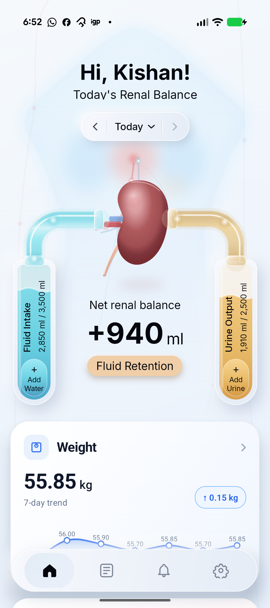
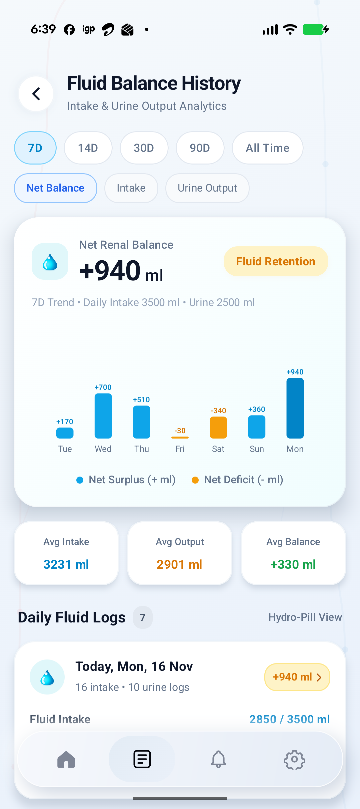
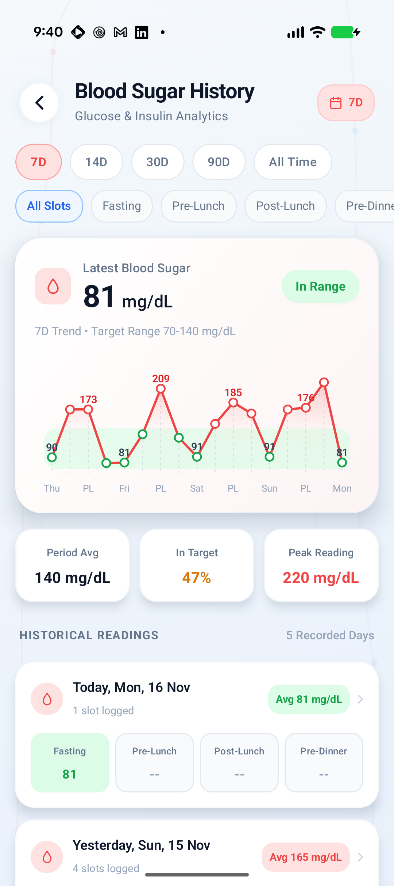

# 🩺 TrackWell — Clinical Renal & Metabolic Companion

<p align="center">
  
</p>

<p align="center">
  <strong>An offline-first, production-grade Android clinical companion for kidney transplant recipients and chronic renal patients.</strong>
</p>

<p align="center">
  <a href="https://kotlinlang.org"></a>
  <a href="https://developer.android.com/jetpack/compose"></a>
  <a href="https://developer.android.com/training/data-storage/room"></a>
  <a href="https://dagger.dev/hilt/"></a>
  <a href="https://developer.android.com/about/versions/15"></a>
  <a href="LICENSE"></a>
</p>

---

## 📖 Overview

Post-transplant care requires relentless daily vigilance: calculating net fluid intake versus output, spotting early fluid retention through morning dry weight, managing tight glycemic targets, and strictly adhering to immunosuppressive regimens.

**TrackWell** replaces fragile paper logs and fragmented spreadsheets with a medically tuned, privacy-first mobile companion. Engineered specifically for renal care routines, TrackWell pairs robust offline persistence with an expressive **Aura Claymorphic & Vascular** design language.

---

## 📸 Screenshots Showcase

| Home Dashboard | Fluid Intake & Output | Day History Breakdown |
|:---:|:---:|:---:|
|  |  |  |

| Weight Quick Adjust | Glycemic History Ribbon | Medication Schedule |
|:---:|:---:|:---:|
|  |  |  |

---

## 🌟 Core Features

### 💧 Fluid Balance & Retention Monitoring
- **Dual Intake vs. Output Tracking:** Track water, tea, electrolytes, and urine output in millilitres (ml).
- **Net Fluid Balance:** Live calculation (`Total Intake - Total Urine`) with clinical color coding to instantly identify hypervolemic (fluid retention) or hypovolemic (dehydration) states.
- **Fast 2-Tap Logging:** Quick-add bottom sheet featuring fast volume chips (`50`, `100`, `150`, `200`, `250` ml) and an tactile custom numeric keypad.
- **Dynamic Progress Ring:** Animated circular gauge showing intake relative to the patient's daily target.

### ⚖️ Morning Dry Weight Sentinel
- **Dry Weight Baseline:** Track morning weight to two decimal places (kg).
- **Rapid Gain Detection:** Automatic alert when a sudden weight spike (>1.0 kg over 48 hours) occurs, signalling potential fluid retention or edema before clinical complications arise.
- **Micro-Adjustment Controls:** Tactile stepper and quick offsets (`-0.5`, `-0.2`, `-0.1`, `Target`, `+0.1`, `+0.2`, `+0.5`).

### 🩸 Glycemic Waveform & Insulin Tracking
- **4 Clinically Aligned Slots:**
  - *Before Breakfast* (Fasting)
  - *Before Lunch* (Pre-meal)
  - *After Lunch* (Post-meal)
  - *Before Dinner* (Pre-meal)
- **Time-Aware Slot Suggestion:** Automatically pre-selects the relevant testing window based on local time.
- **Glycemic Waveform Ribbon:** Visual waveform showing glucose trajectory throughout the day.
- **Insulin Dose Stepper:** Record rapid-acting or basal units alongside readings.
- **Outlier Banners:** Immediate visual feedback when values diverge from patient targets.

### 💊 Immunosuppressant & Medication Management
- **Rigorous Regimen Tracking:** Built specifically for critical medications (Tacrolimus, Mycophenolate, Prednisolone, antihypertensives).
- **Time-Specific Dose Schedules:** Set morning, afternoon, evening, and bedtime dosage plans.
- **Actionable Notification Reminders:** High-priority alarms with one-tap "Took it" confirmations.
- **Pause & Resume Controls:** Flexible temporary pause states for clinical adjustments.

### 📲 Home-Screen Widgets (Jetpack Glance)
- **Fluid Quick-Add Widget (2x1):** Immediate logging from the home screen without launching the full app.
- **Daily Fluid Balance Widget (4x2):** Glanceable progress ring, total intake, urine output, and net balance.
- **Blood Sugar Widget:** Next scheduled test slot and latest reading with one-tap entry.
- **Weight Widget:** Current dry weight and morning prompt.

### 🤖 AI-Assisted OCR Data Import
- **On-Device Optical Character Recognition (ML Kit):** Scan printed or handwritten historical logs via camera or gallery without data leaving the phone.
- **Auto-Layout Detection:** Heuristic engine separating fluid logs from glycemic tables.
- **Interactive Review Table:** Color-coded confidence scores highlighting ambiguities. Allows users to **Merge**, **Overwrite**, or **Skip** dates with duplicate detection.
- **Import Rollback / Undo:** Every imported batch is tracked with one-click undo capability.
- **Optional Gemini API:** Optional integration for advanced handwriting interpretation.

### 📄 Clinical Exports & Encrypted Backup
- **Doctor-Ready Vector PDF:** Native `PdfDocument` generation producing clean, multi-page clinical reports complete with patient metrics, daily averages, and doctor sign-off lines.
- **Multi-Sheet Excel (.xlsx):** Structured workbooks separating fluid balance, sugar & insulin, and daily summaries.
- **CSV Export:** Fast, standard comma-separated exports compatible with any analytical software.
- **Encrypted Google Drive Sync:** Background backup with AES-256 local export encryption.

---

## 🎨 Design Philosophy: Aura Claymorphic & Vascular

TrackWell is crafted with a bespoke design system combining **Aura Claymorphic depth** and anatomical **Vascular fluid flows**:
* **Claymorphic Surfaces:** Soft inner and outer shadows, rounded contours, and translucent frosted glass overlays.
* **Anatomical Visuals:** Custom-rendered vascular background channels and renal backdrop shaders.
* **Haptic & Visual Feedback:** Dynamic micro-interactions, responsive spring physics, and high-contrast clinical accessibility.

---

## 🏗️ Architecture & Tech Stack

TrackWell adheres to Google's official **Clean Architecture & Android App Architecture** recommendations:

```
app/
├── alarms/               # AlarmManager punctuality handlers & BootReceiver
├── data/
│   ├── local/database/   # Room DB (Entities, DAOs, TypeConverters)
│   ├── local/preferences/# Jetpack DataStore for user thresholds & targets
│   ├── medicine/         # Medicine repository implementations
│   └── importexport/     # PDF vector generation & Excel/CSV parsers
├── domain/               # Domain models, clinical calculations & use cases
├── notification/         # Notification channels & rich action handlers
├── ui/
│   ├── common/           # Claymorphic 3D icons, reusable dialogs & steppers
│   ├── home/components/  # Renal backdrop, fluid rings, vascular canvas
│   ├── navigation/       # Jetpack Compose Navigation & NavRoutes
│   ├── screens/          # Feature screens (Today, Fluid, Sugar, Weight, Meds, Export, Import)
│   └── theme/            # TargetTokens, Color, Shape, Typography, DesignScale
├── widget/               # Jetpack Glance home-screen widgets & quick entry
└── worker/               # WorkManager background tasks (fluid nudges, auto-backups)
```

### Key Libraries & Components
* **UI & Styling:** Jetpack Compose (1.7), Material 3, Accompanist System UI Controller
* **Dependency Injection:** Dagger Hilt
* **Database & Storage:** Room Database, EncryptedSharedPreferences, Jetpack DataStore Preferences
* **Home-Screen Widgets:** Jetpack Glance
* **Background Tasks:** AndroidX WorkManager & AlarmManager
* **Machine Learning / OCR:** Google ML Kit Text Recognition
* **Reports:** Android Native `PdfDocument` & Apache POI (Streaming OpenXML)
* **Concurrency:** Kotlin Coroutines & Reactive StateFlow

---

## 🚀 Getting Started

### Prerequisites
* **Android Studio:** Ladybug (2024.2.1) or newer
* **JDK:** Version 17
* **Android SDK:** 
  * Compile SDK: `35`
  * Target SDK: `35`
  * Minimum SDK: `26` (Android 8.0 Oreo)

### Building & Running

1. **Clone the repository:**
   ```bash
   git clone https://github.com/KishanMevada/TrackWell.git
   cd TrackWell
   ```

2. **Open the project in Android Studio:**
   - Select **File > Open...** and navigate to the cloned `TrackWell` directory.
   - Allow Gradle to sync dependencies.

3. **Build the Debug APK:**
   ```bash
   ./gradlew assembleDebug
   ```

4. **Run Unit Tests:**
   ```bash
   ./gradlew test
   ```

5. **Deploy to a connected device or emulator:**
   ```bash
   ./gradlew installDebug
   ```

---

## 🔒 Privacy & Security

* **100% Offline-First:** All health data (intake, urine, weight, glucose, doses) is stored locally on the patient's device in an encrypted Room SQLite database.
* **No Telemetry / No Tracking:** Zero analytics SDKs, trackers, or unexpected outbound connections.
* **Biometric Lock Support:** Integrated biometric / PIN prompt safeguarding sensitive clinical data from unauthorized access.

---

## 📄 License

This project is open-source and available under the terms of the [MIT License](LICENSE).

---

## 👨‍💻 Author

**Kishan Mevada**  
GitHub: [@KishanMevada](https://github.com/KishanMevada)
