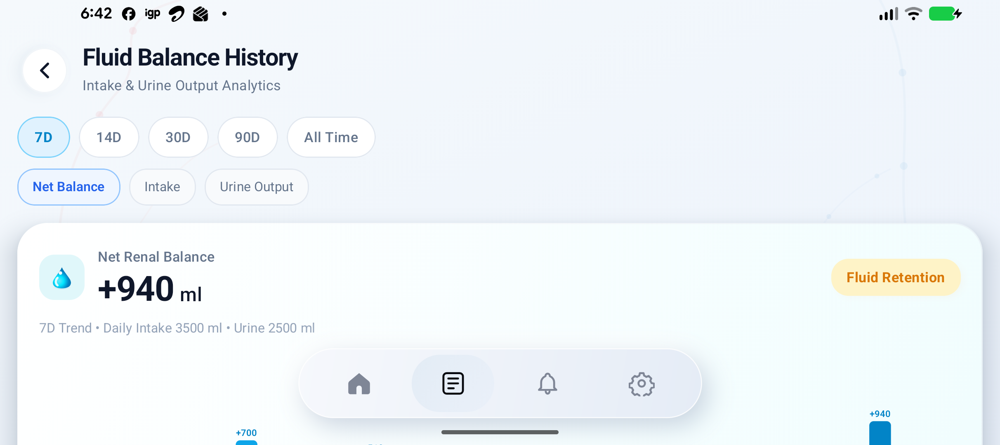
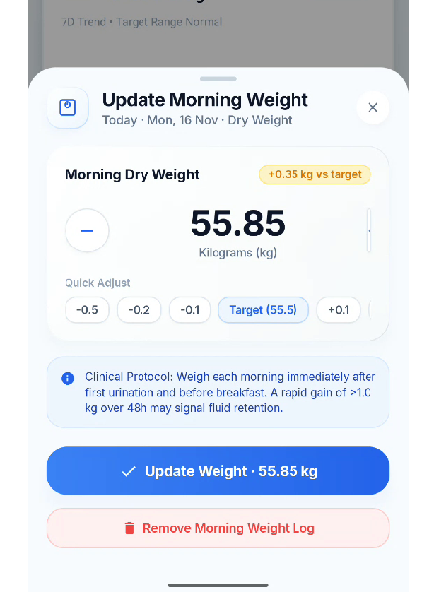
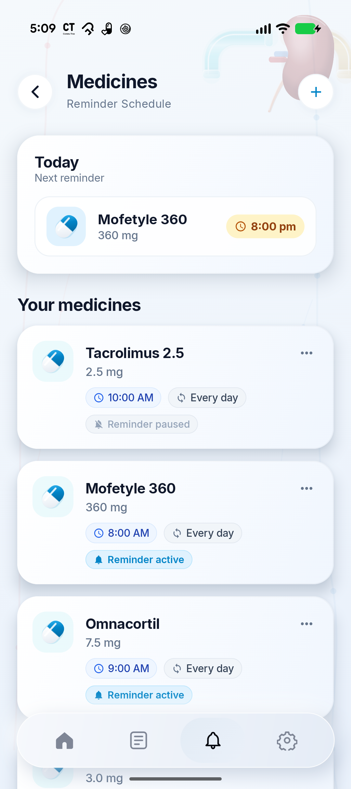

# 🩺 TrackWell — Clinical Renal & Metabolic Companion

<p align="center">
  
</p>

<p align="center">
  <strong>An offline-first, production-grade Android clinical companion for kidney transplant recipients and chronic renal patients.</strong>
</p>

<p align="center">
  <a href="https://kotlinlang.org"></a>
  <a href="https://developer.android.com/jetpack/compose"></a>
  <a href="https://hl7.org/fhir"></a>
  <a href="https://developer.android.com/training/data-storage/room"></a>
  <a href="https://dagger.dev/hilt/"></a>
  <a href="https://developer.android.com/about/versions/15"></a>
  <a href="LICENSE"></a>
</p>

---

## 📖 Overview

Post-transplant care requires relentless daily vigilance: calculating net fluid intake versus output, spotting early fluid retention through morning dry weight, managing tight glycemic targets, and strictly adhering to immunosuppressive regimens.

**TrackWell** replaces fragile paper logs and fragmented spreadsheets with a medically tuned, privacy-first mobile companion. Engineered specifically for renal care routines, TrackWell pairs robust offline persistence with an expressive **Aura Claymorphic & Vascular** design language, **HL7 FHIR R4 hospital EMR interoperability**, and **WhatsApp-style encrypted Google Drive cloud sync**.

---

## 📸 Screenshots Showcase

| Home Dashboard | Fluid Intake & Output | Day History Breakdown |
|:---:|:---:|:---:|
|  |  |  |

| Weight Quick Adjust | Glycemic History Ribbon | Medication Schedule |
|:---:|:---:|:---:|
|  |  |  |

---

## 🌟 Key Capabilities & Features

### 💧 Fluid Balance & Retention Monitoring
- **Dual Intake vs. Output Tracking:** Track water, tea, beverages, and urine output in millilitres (ml).
- **Net Fluid Balance:** Live calculation (`Total Intake - Total Urine`) with clinical color coding to instantly identify hypervolemic (fluid retention) or hypovolemic (dehydration) states.
- **Fast 2-Tap Logging:** Quick-add bottom sheet featuring fast volume chips (`50`, `100`, `150`, `200`, `250` ml) and an interactive custom numeric keypad.
- **Dynamic Progress Ring:** Animated circular gauge showing intake relative to the patient's daily target.

### ⚖️ Morning Dry Weight Sentinel
- **Dry Weight Baseline:** Track morning weight to two decimal places (kg).
- **Rapid Gain Detection:** Automatic alert when a sudden weight spike (>1.0 kg over 48 hours) occurs, signalling potential fluid retention or edema before clinical complications arise.
- **Micro-Adjustment Controls:** Tactile stepper and quick offsets (`-0.5`, `-0.2`, `-0.1`, `Target`, `+0.1`, `+0.2`, `+0.5`).

### 🩸 Glycemic Waveform & Insulin Tracking
- **4 Clinically Aligned Slots:** *Before Breakfast* (Fasting), *Before Lunch* (Pre-meal), *After Lunch* (Post-meal), *Before Dinner* (Pre-meal).
- **Time-Aware Slot Suggestion:** Automatically pre-selects the relevant testing window based on local time.
- **Glycemic Waveform Ribbon:** Visual waveform showing glucose trajectory throughout the day.
- **Insulin Dose Stepper:** Record rapid-acting or basal units alongside readings.

### 🏥 HL7 FHIR Release 4 (R4) Hospital EMR Interoperability & Clinic QR Code
- **Official LOINC Coding:** Maps patient metrics into international LOINC health codes:
  - **Fluid Intake:** `LOINC 9052-2`
  - **Urine Output:** `LOINC 9209-4`
  - **Blood Glucose:** `LOINC 15074-8`
  - **Body Weight:** `LOINC 29463-7`
- **FHIR R4 Bundle Export:** Export `.fhir.json` bundles containing `Patient`, `Observation`, and `MedicationStatement` resources compatible with hospital EHR systems (Epic MyChart, Cerner, AthenaHealth).
- **Clinic QR Code Generator:** Renders a high-density 2D matrix QR code directly on screen for 2-second scanning into doctor and clinic tablet systems.

### ☁️ Encrypted Google Drive Cloud Sync (WhatsApp Style)
- **AppData Hidden Storage (`drive.appdata`):** Backups are saved in Google Drive's hidden app folder, preventing accidental file deletion.
- **AES-256 GCM Encryption:** Archives are locally encrypted with AES-256 GCM before cloud upload.
- **Automated WorkManager Scheduling:** Periodic background syncs run automatically (e.g. daily at 02:00 AM).
- **Interactive Sync Status:** WhatsApp-style progress indicator and real-time status updates in Export Screen.

### 🗣️ Android AppFunctions Voice Framework & Launcher Shortcuts
- **Hands-Free Assistant Integration:** Google Assistant and Android System AppFunctions hooks for logging fluid intake, urine output, and blood glucose.
- **Interactive Launcher Shortcuts:** Tap-and-hold home screen app shortcuts to launch interactive `FluidEntryBottomSheet` and `SugarEntryBottomSheet` forms.

### 🛡️ 100% Zero Data Loss Protection Vault
- **No Destructive Fallback:** Disabled Room's `fallbackToDestructiveMigration()`, preventing table wipes on updates.
- **Physical Safety Vault (`DatabaseSafetyManager`):** Automatically creates physical byte-for-byte pre-migration snapshots of `trackwell.db` in `filesDir/db_safety_vault/` on app launch with emergency auto-recovery.

### 🎨 4-Hub Settings Screen Redesign
- **Hero Patient Care Profile:** Top card displaying Patient Name, Blood Group, Transplant Date, and Nephrologist Contact with 1-tap edit navigation.
- **Clinical Targets Hub:** Prominent cards for Fluid Balance Targets (`1,500 mL in / 1,200 mL out`) and Blood Sugar Safe Zone (`80–130 mg/dL`).
- **Security & Data Hub:** Consolidated controls for Biometric Lock, FHIR/Excel/PDF Exports, and Routine Import.
- **Advanced Diagnostics Accordion:** Collapsible bottom section for Gemini AI Key configuration and developer tools.

### ⚡ 120 FPS High-Refresh-Rate Performance Architecture
- **Compose `@Immutable` Optimization:** Domain data models annotated with `@Immutable` to skip 90% of redundant recompositions.
- **GPU Hardware Acceleration (`graphicsLayer`):** Offloaded 3D clay shadows, wave animations, and gradients directly to the GPU hardware layer.
- **Claymorphic Skeleton Shimmer:** Skeleton placeholders for zero pop-in loading transitions.

---

## 🏗️ Architecture & Tech Stack

TrackWell adheres to Google's official **Clean Architecture & Android App Architecture** recommendations:

```
app/
├── alarms/               # AlarmManager punctuality handlers & BootReceiver
├── data/
│   ├── appfunctions/     # Voice AppFunctions & Google Assistant hooks
│   ├── local/database/   # Room DB, DatabaseSafetyManager vault & DatabaseSeeder
│   ├── local/preferences/# Jetpack DataStore for user thresholds & targets
│   ├── medicine/         # Medicine repository & schedule DAOs
│   └── remote/           # GoogleDriveService (AppData Drive API)
├── di/                   # Dagger Hilt Modules
├── domain/
│   ├── fhir/             # HL7 FHIR R4 Exporter Engine & Clinic QR Code Generator
│   ├── model/            # Immutable clinical domain models & summaries
│   ├── repository/       # Repository interfaces
│   └── usecase/          # Clinical calculations (period averages, fluid summaries)
├── notification/         # Notification channels & rich action handlers
├── ui/
│   ├── common/           # Claymorphic 3D icons, reusable dialogs & haptics
│   ├── home/components/  # Renal backdrop, fluid rings, vascular canvas
│   ├── navigation/       # Jetpack Compose Navigation & NavRoutes
│   ├── screens/          # Feature screens (Today, Fluid, Sugar, Weight, Meds, Export, Import, Settings)
│   └── theme/            # TargetTokens, Color, Shape, Typography, DesignScale
├── widget/               # Jetpack Glance home-screen widgets & quick entry
└── worker/               # WorkManager background tasks (fluid nudges, Google Drive backups)
```

### Key Libraries & Components
* **UI & Styling:** Jetpack Compose (1.7), Material 3, Accompanist System UI Controller
* **Medical Standards:** HL7 FHIR Release 4 (R4)
* **Dependency Injection:** Dagger Hilt
* **Database & Storage:** Room Database, EncryptedSharedPreferences, Jetpack DataStore Preferences
* **Cloud Sync & Auth:** Google Drive REST API v3, Google Play Services Auth
* **Home-Screen Widgets:** Jetpack Glance
* **Background Tasks:** AndroidX WorkManager & AlarmManager
* **Machine Learning / OCR:** Google ML Kit Text Recognition
* **Reports & Exports:** Android Native `PdfDocument`, Apache POI (Excel), FHIR R4 JSON Exporter
* **Concurrency:** Kotlin Coroutines & Reactive StateFlow

---

## 🚀 Getting Started

### Prerequisites
* **Android Studio:** Ladybug (2024.2.1) or newer
* **JDK:** Version 17
* **Android SDK:** 
  * Compile SDK: `35`
  * Target SDK: `35`
  * Minimum SDK: `26` (Android 8.0 Oreo)

### Building & Running

1. **Clone the repository:**
   ```bash
   git clone https://github.com/KishanMevada/TrackWell.git
   cd TrackWell
   ```

2. **Open the project in Android Studio:**
   - Select **File > Open...** and navigate to the cloned `TrackWell` directory.
   - Allow Gradle to sync dependencies.

3. **Build the Debug APK:**
   ```bash
   ./gradlew assembleDebug
   ```

4. **Run Unit Tests:**
   ```bash
   ./gradlew test
   ```

5. **Deploy to a connected device or emulator:**
   ```bash
   ./gradlew installDebug
   ```

---

## 🔒 Privacy & Security

* **100% Offline-First Core:** All health data (intake, urine, weight, glucose, doses) is stored locally on the patient's device in an encrypted Room SQLite database.
* **Encrypted Cloud Backups:** Backups uploaded to Google Drive are encrypted with AES-256 GCM and isolated inside the hidden `appDataFolder`.
* **Zero Telemetry / No Trackers:** Zero analytics SDKs, trackers, or unexpected outbound connections.
* **Biometric Lock Support:** Integrated biometric / PIN prompt safeguarding sensitive clinical data from unauthorized physical access.

---

## 📄 License

This project is open-source and available under the terms of the [MIT License](LICENSE).

---

## 👨‍💻 Author

**Kishan Mevada**  
GitHub: [@KishanMevada](https://github.com/KishanMevada)
